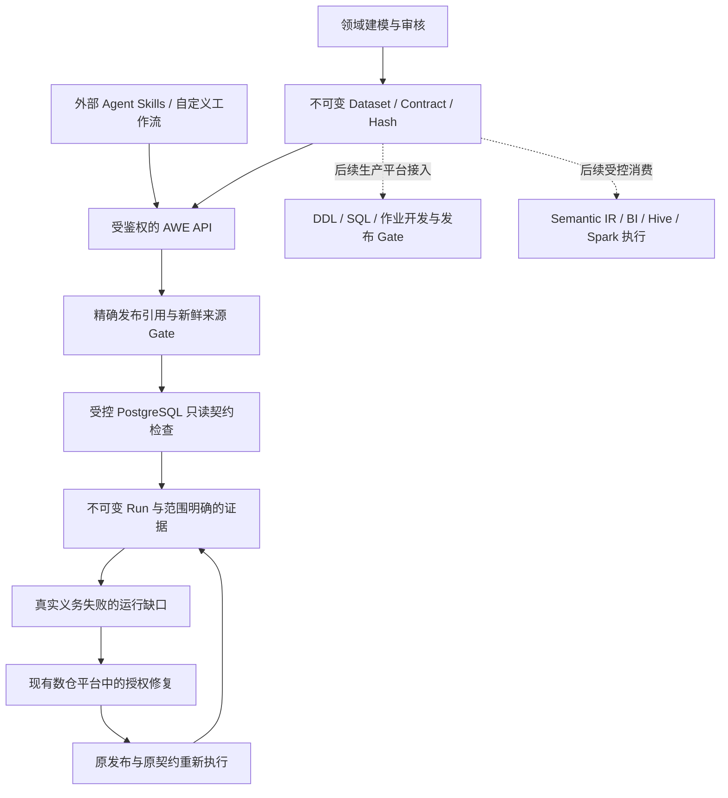

# ADR-014：Agent Skills 与版本化数据验证、修复回放

状态：本增量建立的执行边界；以真实 PostgreSQL 集成测试验收。生产目标至少覆盖 F3，当前纵切面不代表 F1 企业接入、F2 语义查询或 F3 全部能力已经完成。

后续产品定位与交付优先级由 [ADR-015](adr-015-domain-knowledge-and-controlled-consumption.md) 更新：统一知识库内部演进，成熟域可信消费先行，再实施该域新增/变更准入。本文保留已交付只读检查的范围，不将其扩写为已经具备问数、取数或业务验收能力。

## 目标：从实现资产转向共享的模型与契约

现有数仓以表、SQL、作业和报表交付实现。AWE 在这些实现之上建立不可变的实体、关系、语义模型、契约和能力，并将来源、执行版本及证据纳入同一条可追溯链。生产、消费和验证都应使用这些发布定义；现有 Hive/Spark/BI/调度平台继续承担物理计算和数据存储职责。

验收问题必须具体到：模型是否约束了真实数据任务，任务使用了哪个发布与来源，失败是否有可检查的证明，修复是否改变真实数据或实现，以及回放是否通过相同的证明义务。只发布模型、展示元数据或生成分析说明不能替代这些事实。

本轮优先完成一个边界明确的真实执行纵切面：版本 Dataset + 版本 Contract → 真实只读数据检查 → 持久化失败与缺口 → 外部修复真实数据 → 相同版本契约重新执行并关闭该缺口。

实线表示本轮可验收的只读验证与外部修复回放链；虚线仍需后续工程。图中没有赋予 AWE 写入数仓或 Agent 自行认证业务事实的权限。

## Agent 可以拥有 Skills 与流程，AWE 负责执行边界

Agent 可以在自己的仓库、个人配置或工作流平台保存 Skills，组合业务步骤、选择候选模型、安排检查并解释结果。这些内容由调用方管理，不要求成为 AWE Registry 中的新元模型，也不要求为每个实体运行一个 Agent。

Skills 调用稳定的 AWE API，并提交明确发布 ID、内容 Hash、结构化参数和幂等键。AWE 在服务端重新判定身份、类型、版本、来源就绪和已注册能力，不因 Skill 内容、自然语言指令或客户端声称“已审批”而放宽检查。未来 Function/Action 执行器也必须走相同边界。

本轮只执行注册的数据检查规则。Skill 不能提交任意 SQL、脚本、数据库 URL、物理关系名或可执行代码；关系映射和连接由运维配置。Action 元模型仍可发布声明，本轮不执行回补、任务重跑或数据修改。

## 已注册的运行契约

Contract 的 subject 必须固定为目标 Dataset 的精确版本。运行请求同时固定 Dataset 和 Contract 的 Release ID 与内容 Hash，服务端校对后执行它们，不用“最新模型”替换请求的历史定义。

| EXECUTE 规则 | 真实检查 | 证明范围 |
|---|---|---|
| `check.grain.unique` | 在检查关系中按 Dataset 粒度键检查重复 | 这次完整受限扫描中的粒度唯一性 |
| `check.grain.not_null` | 检查粒度键的空值 | 这次扫描中的粒度键非空性 |
| `check.time.available_after_event` | 按绑定映射检查可获得时间不早于事件时间 | 该时间约束；不等同于完整历史特征/PIT 认证 |

发布包含这些 EXECUTE 义务的 Contract 时检查规则、阶段和适用性；发布不冒称执行通过。首个运行能力要求一个 Dataset 直接来源绑定，多个绑定的联合执行尚未支持。运行时使用注册的服务端实现，不用 Contract 中的任意字符串作为 SQL 或代码。未支持的阻断规则不能作为已经执行的义务放行。

## 数据来源、读取边界与证据

首个数据执行组件是 `JdbcContractExecutor`，当前支持 PostgreSQL。`AWE_WAREHOUSE_ASSET_BINDINGS` 把已有来源资产标识映射到运维允许的 PostgreSQL `schema.table`。即使模型来源标识为 `hive`，这次检查证明的也是所配置 PostgreSQL 关系中的数据；它不意味着已经原生读取 Hive。原生 Hive/Spark/BI 执行仍需各自适配器和真实平台验收。

执行前重新检查 Dataset 的元数据来源及模型物理契约。之后用只读、repeatable-read 事务读取配置关系，设置连接、查询和行数边界。连接使用另外配置的只读源端身份，应用的只读事务不能代替数据库授权。远程 PostgreSQL 使用证书与主机名校验，不通过关闭 TLS 验证排障。

扫描使用 `LIMIT(maxRows + 1)` 判定是否超出范围。超限与空关系均为 `INCONCLUSIVE`，不把部分行或零行冒称完整数据通过。缺少连接或资产映射返回 `NOT_CONFIGURED`，源端不可用返回 `UNAVAILABLE`。检测到所配置关系启用 RLS，或粒度列使用非确定性排序规则时返回 `INCONCLUSIVE`，避免把权限可见子集或不同字符串等价关系冒充完整通过。只有完整范围内本次支持的 EXECUTE 规则通过才能产生 `PASSED`；Contract 其他阶段不会被冒充为已经运行，会列入限制。证明仅涵盖指定规则、关系和事务视图，不涵盖其他分区、来源或未来数据。元数据 Gate 不满足时运行记录为 `BLOCKED`（缺少来源配置仍为 `NOT_CONFIGURED`）。

Run 记录模型与契约 Release/Hash、元数据快照、实际 `data_snapshot_ref`、检查行数、违规计数、状态及限制。数据快照引用采用 `postgresql:binding:<bindingHash>:tx_snapshot_sha256:<snapshotHash>`：`bindingHash` 是 `{jdbcURL,jdbcUser,relation,sourceSystem,externalRef}` 的 SHA-256，`snapshotHash` 是实际 PostgreSQL 事务快照的 SHA-256。该有界引用记录真实读取与映射身份，不暴露连接串或证书路径，也不因为 PostgreSQL 活跃事务列表很大而截断证据。事务结束后不能凭该标识恢复历史数据。它是本次读取的证据，不是 Iceberg 式可恢复历史快照，也不能用于承诺任意历史时点回放。

## 缺口与修复回放

真实检查得到的义务失败产生运行缺口。`NOT_CONFIGURED`、`UNAVAILABLE`、`INCONCLUSIVE` 不自动断言数仓模型或数据有错。旧 Run 和证据不可变；元数据漂移问题与运行数据问题分别保留，不互相冒充。`RUNNING` 是未完成状态，不能当作失败或通过；本增量采用同步执行，不宣称具备跨进程持久工作者的自动恢复能力。

修复由领域团队或其已授权外部工具在真实数据/工程平台完成。AWE 的 replay 请求记录幂等键和修复说明，重新读取当前真实数据，强制使用原运行固定的模型、契约与规则；不能通过更换更宽松契约、修改旧结果或填写“已修复”关闭问题。运行缺口以 `failed_run_id` 固定第一个得到真实 `FAILED` 的证据，以 `original_run_id` 关联原始请求意图；原始请求即使曾经未配置，也不会被冒充为失败证明。只有原发布、原契约的相同检查通过，且数据快照中的 binding Hash 与该失败证据相同，才能关闭对应缺口。事务快照 Hash 可以变化，因为回放读取的是修复后的当前数据。

运维改为另一个关系、JDBC 目标或源端配置身份后，新关系检查可以得到其自身范围的 `PASSED`，但原缺口保持 `OPEN`，并返回范围变化的限制说明；不能用另一张干净关系证明原关系已修复。这条链始终保留失败 → 修复说明 → 新证据的关联。

这验证的是同一契约对修复后数据的重新执行。它不恢复旧数据快照，也不证明修改已经通过所有业务回归或下游验收。生产作业/DDL/SQL 发布、跨下游回归、审批写操作和调度恢复仍需继续建设。

## 验收与阶段边界

自动化集成测试必须使用真实 PostgreSQL：创建错误数据，发布对应模型和执行契约，调用真实 HTTP 运行接口，观察失败证据与缺口；通过测试安排在 AWE 外修改真实行，再按同一版本回放并验证新结果与缺口关闭。还需覆盖版本/Hash 不符、未知规则、来源漂移、缺少连接、越权、幂等冲突、空关系和超限等拒绝/不确定路径。

该纵切面使模型第一次直接约束真实行检查，并使失败推动可验证的数据修复。F1 仍需真实企业来源及领域验收，F2 仍需 Resolver/Semantic IR/权限化查询和 BI 数值对账；F3 仍需生产作业、血缘、质量平台、影响回归和完整缺口工作流。项目目标至少达到这些生产、消费、验证与改进闭环，不能把某个先行纵切面写成整个阶段完成。
