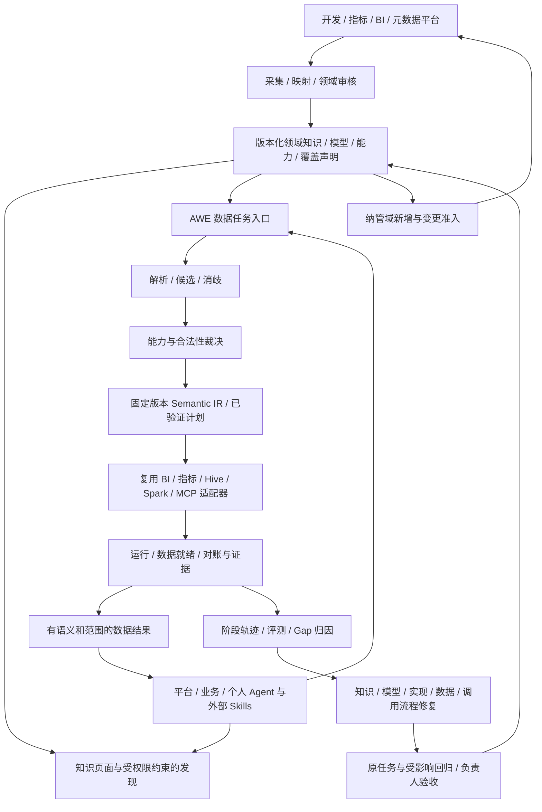

# ADR-015：统一知识库内核、成熟领域消费与逐域准入

状态：根据本轮产品讨论确定的目标与路线调整；本文件中的任务协议、消费链和纳管机制是后续实现约束，不表示已经交付。适用基线：`main` 的 `4acbbe8`。

本 ADR 保留 ADR-001—014 的类型、身份、版本、权限与证据不变量，调整 ADR-012 的交付顺序，以及 ADR-014 之后的产品重心。F0—F6 保留为能力划分，不能据编号宣称已经完成某一阶段。

## 1. 已明确的产品事实与目标

- 知识归集已存在共识：开发平台、BI、指标平台的数据知识可以统一进入现有知识库。对外仍然是这套知识库；AWE 是其内部逐步形成的语义、能力裁决与受控数据使用内核，不另外建设一套竞争的知识库。
- 平台 Agent、业务自建 Agent 和个人 Agent 都是下游消费者。当前存在生成 SQL 访问 Hive/Spark、调用 BI/指标接口及既有 MCP 等多条通道。
- 迁移顺序是：纳入一个成熟业务域的已有资产 → 可靠判断并完成该域约定的问数、取数任务 → 约束该域新增、变更资产 → 再扩展下一个成熟域。
- AWE 成熟后作为纳管域的默认数据链路。现有 SQL/BI/指标/MCP 可以复用为受控执行适配器，也可在明确授权的例外下兜底；不能依赖下游 Skill 自觉选择 AWE 来冒称已经强制纳管。
- 企业连接、平台部署接入由用户线下补齐。仓库必须提供可实现、可测试的适配契约；协议 fixture、参考执行器和 CI 不能代替企业实际接入与业务验收。

长期目标：团队以业务语义、逻辑数据模型、加工意图和可消费能力作为正式设计与交付对象；Hive/Spark/调度/BI 继续承担物理实现与运行职责。AWE 从既有资产消费可靠性出发，逐步把同一设计权威延伸到生产。首轮不要求重建成熟领域的全部加工。

## 2. 当前问题与必须避免的偏移

把检索内容作为上下文交给 Agent，会把含义选择、字段映射、计算路径和结果判断分散到调用方。只改知识描述或不断增加 Skill 硬逻辑，无法稳定区分缺少模型、召回遗漏、语义歧义、非法计划、数据问题和解释错误。

Registry、审批、质量检查和重验是可复用基础；它们本身不能证明数仓交付方式已经改变。继续优先扩展这些管理功能，会使 AWE 成为旁路治理系统：原系统照常产出表和 SQL，领域团队再额外填录模型。

本轮调整后的首要产品交付是成熟领域可信消费链及其可归因反馈。生产准入建立在该领域已明确的模型、能力和验收集上，不能要求先完成所有 F3 管理模块才开放 Resolver、问数与取数。

## 3. 权威与知识对象

| 内容 | 权威与维护方式 | 使用边界 |
|---|---|---|
| 来源事实 | 表结构、实现、血缘、作业状态由对应平台提供；AWE 保留引用、版本及观测 | 动态事实有时效；无配置、不可达和缺少覆盖不能当成不存在 |
| 领域语义 | 领域负责人确认实体、身份、粒度、时间、计算口径和合法关系，经统一发布边界版本化 | 不以向量相似度或 LLM 文本认证业务等价；保留领域自治与合法同名 |
| 可执行约束与能力 | AWE 注册的类型规则、算子、计划验证、能力签名、实现绑定及策略 | 下游可以提议，接受和执行必须经过服务端检查；不能以 Skill 内容授权 |
| 运行证据 | 来自可信适配器、执行记录、独立对账与业务验收，标明范围及盲区 | 治理认证、计算一致、数据质量和业务完成分别记录 |
| 解释文档与案例 | 知识库保留原文、作者、引用和状态；权威页面尽量从同一发布定义生成 | 文档和搜索索引是解释/检索投影，不成为第二份可独立修改的计算真相 |

AWE 内部使用正式模型及关系，外部仍可提供目录、文档、搜索和知识页面。不能把七类 Java 元模型直接作为领域用户必须逐项填报的产品流程。表、指标、实体、能力的正常维护应自动带入定义、来源和验证，减少重复录入。

需要区分语义关联、身份映射、可 Join 关系、计算依赖、实现绑定和运行血缘；不能用一个泛化的“有关联”边承担它们的执行含义。

## 4. 系统边界与默认链路

这是目标架构，不是当前已实现模块图。AWE 可以复用现有平台的 API/MCP，不必重写物理计算引擎。复用的前提是任务、参数、用户身份、语义版本、预算和证据可以贯穿；能力不足时明确返回未支持或未配置。

Agent/Skill 组织用户流程，提出任务意图或候选方案。AWE 管理自己领域内的解析、计划、执行状态、验证、发布和回归状态机；不能把“计划是否合法”“运行是否完成”“是否可认证”交回给下游自行宣告。LLM 可参与候选生成、映射和诊断建议，确定性规则与具名证据决定接受范围，业务负责人决定口径与验收。

知识被授权导出后，AWE 无法控制所有离线推理或保证 Agent 最终叙述正确。认证只绑定相应语义、计划、数据结果与证据。下游改变口径、重新计算或作进一步推断，不能继续沿用原认证；未收到最终回答及任务反馈时，整体任务完成保持未评估。

## 5. 成熟领域知识契约与任务协议

以下是目标协议约束，不是已经存在的 API 字段。实现应先提供统一内核与状态机，再映射知识库 API、REST、MCP 等传输方式；不能要求 Agent 自行串联若干检查就获得执行许可。

**领域覆盖声明**必须有负责人和版本：业务域、来源/资产范围、支持的问题与操作、时间及快照范围、覆盖证据、更新时效、已知缺口、纳管入口与例外。分别记录已归集、已建模、已验证、已强制准入的范围；这些状态不是同一个完成度。覆盖声明也不能无条件证明企业范围内不存在其他数据。

有界规划未找到合法路径，只能说明在已注册算子、语义约束、搜索和资源边界内未找到。不能由目录覆盖或搜索失败推断任意加工都不可能；DERIVABLE 也必须有可验证计划，不能来自语言模型的可行性描述。

**问数契约**必须显式表达指标的度量字段/表达式、单位、过滤、人群、去重身份、时间窗口/时区、粒度、可用维度与聚合/关联限制，以及可执行实现绑定。当前 Metric 的聚合种类和来源引用不足以自动完成这些定义，不能从名称/描述猜测缺省含义。

**取数契约**同等重要：实体或 Dataset、输出行粒度、字段类型/单位、允许的维度/过滤、时间区间、必要的历史可获得时点、脱敏与 PII、行/字节/分页上限、用途、导出权限和有效期。能查到指标值不代表已经支持安全取数；接口不能接受任意 SQL 或通过宽权限账户隐式扩大范围。

任务接受前必须记录调用用户和委托身份、用途、域、原始意图、结构化语义槽位、请求与预算。调用者不能自行声明角色或审批。解析后固定模型 Release/Hash、来源/策略版本、计划/制品身份及缓存有效条件；执行时重新检查当前授权与数据状态。

响应不能用一个成功率或 SUCCESS 覆盖全部事实，至少分开：

| 维度 | 必须表达的状态或事实 |
|---|---|
| 语义解析 | 已解析、歧义需澄清、未解析；候选及选择依据按权限可见 |
| 能力供给 | DIRECT、DERIVABLE、MISSING、UNKNOWN；MISSING 需要声明范围内的覆盖证据 |
| 访问 | 允许、拒绝、未知及可披露的原因；未知授权不能执行 |
| 就绪 | 就绪、未到齐、未配置、不可达、未知；与能力存在分开 |
| 执行与验证 | 未运行/运行中/终态，与具体义务通过、失败、部分或不可判定分开 |
| 数据结果 | 数值/数据集及单位、人群、时间、粒度、版本、来源；0、无记录、未就绪等不同 |
| 任务完成 | 用户/业务接受、拒绝或尚未评估；Agent 文案不自动成为业务验收 |

需要固定任务级与阶段级 Trace：检索请求/索引快照、候选与过滤原因、解析结果、证明义务、计划与预算、实际执行身份/制品、来源和数据快照、验证结果及使用反馈。受限资产存在性、原始数据与完整诊断只向适当角色开放，不能借错误归因泄露权限外信息。

## 6. 失败归因与知识使用闭环

| 观测 | 可确认的前提与归因 | 修复位置 |
|---|---|---|
| 范围内没有正式模型 | 来源/目录覆盖已确认，缺少具体定义或能力 | 领域建模/知识生产；无覆盖时仍为 UNKNOWN |
| 正确模型存在但未进入候选 | 可复现的索引、权限过滤和召回 Trace 支持 | 检索/索引/术语映射 |
| 候选均合法但含义不同 | 领域命名空间、权威和上下文不足以唯一选择 | 澄清；必要时补充明确的消歧政策 |
| 计划违反粒度/时间/聚合/关联 | 服务端证明义务明确失败 | 计划/规则/计算定义；不通过修改文案绕过 |
| 来源、数据或任务异常 | 可信运行与质量证据说明发生点，根因可继续未知 | 数据/加工/工具/运行平台 |
| 权威结果正确，最终回答口径变化 | 获得最终回答及对应结果引用后可比较 | Agent 使用或解释流程；不因此修改正确模型 |

错误可以多因并存；阶段观测与根因假设分开。UNKNOWN、权限拒绝、数据未到、来源未配置不自动变成“缺知识”工单。先去重形成带证据的候选，再由责任方归因、分配、修复并回放。技术检查恢复与领域业务接受分别记录；用同一生成逻辑检查自身输出不能替代独立对账。

线上失败必须回流为有责任人、证据及验收集的改进：修复原任务，并运行相关语义、消费及下游回归。评测集区分开发例、独立保留例和生产观测，保留口径/源数据版本，避免只优化已见问题描述。

## 7. 默认链路、执行复用与兜底

- 纳管域的知识库/Agent 工具发现优先暴露 AWE 数据任务能力。已有 BI/指标/MCP 适配器在 AWE 接受的语义与计划下执行，是正常实现路径。
- 既有自由 SQL 或直接 MCP 路径作为例外兜底时，必须具名记录原因、授权主体、语义范围、预算、来源、结果验证级别、责任人和退出条件；例外身份不自动继承 AWE 认证。
- DENIED、需要澄清、非法计算、预算拒绝、数据未就绪，不能自动换通道放行；不允许换共享高权限账户，不允许精确口径隐式降为近似，也不允许把旧数据当作同等就绪结果。
- 未支持/UNKNOWN 的兜底需要独立授权并保留限制。若兜底结果可被同等语义和证据要求重新验证，只能提升相应范围的证明，不能把整条未受控路径标为已纳管。
- 强制纳管需要实际工具路由、端点权限、委托身份和来源侧授权配合。Skill 提示词不能阻止仍有直连权限的客户端绕开 AWE；未覆盖入口必须如实列入覆盖/例外清单。
- 持续跟踪正常 AWE 路由、通过受控适配器执行、例外兜底和未纳管直连，不能把兜底调用计入 AWE 正常完成率。已有直连权限迁移由平台线下实现，仓库预留策略/适配契约与拒绝行为。

### 线下平台适配的接口契约

协议可采用原有 API/MCP，以下职责必须有明确字段、身份和失败语义：

| 职责 | 契约要求 |
|---|---|
| 描述/发现 | 能力签名、来源/实现版本、数据语义映射、支持范围与受权限过滤的可见性；未知不伪造能力 |
| 授权/准入 | 真实主体与委托、用途、模型/计划/制品 Hash、策略版本和预算；客户端自填声明不能授予权限 |
| 执行/状态 | 经过验证的参数或制品、幂等键、执行身份、Run ID、异步状态、超时/取消与已支持的恢复方式；不使用调用成功代替作业完成 |
| 证据/验证 | 实际输入输出、快照/水位、实现身份、权限范围、质量/对账结果及限制；来自可信执行系统，不能靠请求方提交 PASSED |
| 生产变更 | 候选模型与制品、影响范围、回归与审批收据、实际部署身份；收据过期、候选变更或制品不符必须拒绝 |

每个适配器交付包括协议正反例、鉴权/预算/幂等/状态/快照契约测试，以及真实环境的连通与业务验收步骤。参考 PostgreSQL 执行器和 HTTP fixture 各自说明已证明范围；空接口或返回固定成功的适配器不能算接入完成。受控适配器不能表达所需语义或传播授权时，该能力保持不支持，不用扩大共享账户权限补齐。

## 8. 实际推广顺序

| 里程碑 | 交付与准入 | 退出条件 |
|---|---|---|
| M0 成熟域基线 | 采集已有资产与知识，映射并审核语义；记录权威/覆盖/权限/实际取数路由；建立真实任务与独立参考 | 领域负责人确认支持边界、未解决问题、对账方式及验收责任；不要求重做全部资产 |
| M1 成熟域可信消费 | 正式支持问数与取数的解析、直接能力/有界推导、受控执行、证据、拒绝与阶段归因；影子对账后切换默认工具链 | 约定支持任务通过独立验收；合法歧义、拒绝、未知、数据未到处理正确；失败能归因并回放；兜底单独统计 |
| M2 本域新增与变更准入 | 新建/变更资产绑定模型、实现制品和策略；分析传递与共享物理资产影响，执行受影响回归；既有开发平台强制检查收据 | 实际部署/发布路径无法复用过期或错制品批准；模型和实现受控演进，修复按原任务及影响范围验收 |
| M3 逐域复制与联合 | 下一成熟域重复 M0→M1→M2；共享本体/跨域权限、口径冲突和合法关联需单独认证 | 域边界、所有权与覆盖可追溯，跨域能力不因单域成功自动开放 |

F0/F1 支撑 M0，F2 和必要的 F3 运行证据/反馈支撑 M1，F1/F3 的生产约束支撑 M2。F4/F5 中某项语义若是该成熟域真实任务的前提，就提前实现并验收该项，或明确不在首轮支持范围，不能因编号较晚而使用错误替代计算。M1 的能力合法性与运行安全不能推迟到 F4/F6。

指标分别衡量领域支持覆盖、正确完成/正确澄清/正确拒绝、召回/解析错误、执行与数据异常、验证充分性、Agent 解释错误、例外兜底、问题修复回归及维护成本。指标口径与阈值由领域验收基线确定，不把大量拒答包装成高准确率，也不把 SQL 成功当成任务完成。

## 9. 当前工程可复用基础与真实缺口

| 当前代码事实 | 可复用价值 | 后续必要工作 |
|---|---|---|
| 七类内核、严格 v2 Registry、版本/Hash/来源绑定 | 统一身份与发布边界 | 领域友好的知识导入/映射/审核/展示；覆盖声明与搜索投影 |
| Metric 有来源、聚合、时间、维度声明 | 计算约束的基础 | 完整类型化度量/过滤/窗口/映射，Resolver、Semantic IR、执行与对账；当前不能自动可信问数 |
| Pipeline 为 ObjectType 家族 | 对象定义基础 | 正式输入输出、转换意图、代码制品/运行绑定及生产准入，不能由“类型存在”宣称生产建模完成 |
| 元数据网关与 PostgreSQL 三类只读行检查 | 来源 Gate、范围明确的执行与技术恢复证明 | 真正问数/取数、可信任务与就绪观测、委托权限、引擎适配和独立验证 |
| 直接依赖查询、技术缺口 OPEN/CLOSED | 初始依赖与失败记录 | 传递/共享资产影响、归因/责任/评审、业务接受与影响回归 |
| 两个 Bootstrap Token | 隔离环境开发鉴权 | 真实主体、委托、域/行列/用途策略、源端再鉴权；当前不可声称生产权限完成 |

本 ADR 不要求推倒内核或另外建设 Agent 产品；调整后续优先级和必要契约。M1 是下一主要产品里程碑；在覆盖、语义、权限和证据未具备前，不扩大自动化执行范围。

## 10. 风险与决策约束

1. **并行权威与人工填报**：知识页面/索引从同一权威发布生成并保留来源；导入与开发流程减少重复录入，关注实际维护成本。
2. **模型存在但计算含义缺失**：必须有可执行定义及反例，不能从 Java 类数量、页面或测试数量推断问题解决能力。
3. **缺少知识/召回失败/Agent 错误混同**：任务分阶段证据、覆盖声明、受权限保护的诊断和独立回归是发布条件。
4. **权限与认证随知识外流**：限制发现/导出，源端再鉴权，认证绑定结果与范围；不承诺控制已导出内容的所有本地推断。
5. **兜底常态化**：保留明确例外、原因、责任与退出计划，禁止通过兜底绕过拒绝或把它算作主链路达成。
6. **数据变化与不可恢复回放**：模型/实现/策略/数据状态分开；恢复历史快照与修复后重验分开，证据说明无法重建的部分。
7. **阶段编号驱动而非任务驱动**：保留 F0—F6 能力地图，按 M0—M3 的完整领域任务验收推进；不能用旁路质量循环替代生产消费转型。

在上述受控范围与验收条件成立、实际平台适配接入后，AWE 可以支撑第一阶段的原始转型目标。它不承诺回答任意未知问题、证明全部业务真值、替换物理数仓或接管 Agent 的所有用户流程。
